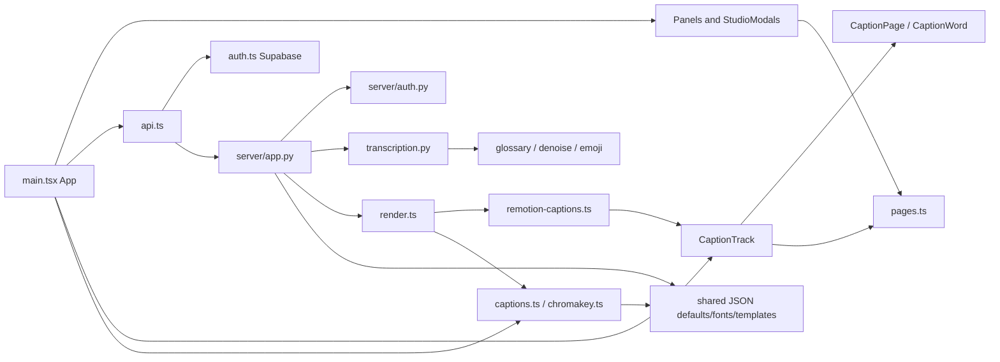

# Dependency and call map

Audited 8–9 October 2026 (Asia/Kolkata). Baseline: `d9691b668312dfdc4adc22310698b8b073921b14` plus the pre-existing working-tree changes fingerprinted in [inventory.json](inventory.json). No application source was changed.

Changes to Word/Settings must update types.ts, Pydantic schemas, editor persistence and render validation together. Template/font additions must update shared catalogs and actual headless font imports. Authentication changes must cover fetch/XHR plus media element/download URLs and both server entrypoints. Scene changes must cover preview and export, not just Remotion captions. Job changes must preserve atomic metadata operations and generation fencing.

## Static local import relationships

This is parser-derived import linkage, not a complete dynamic call graph. Python relative/dynamic imports, framework entrypoints, JSON file reads and callback prop invocation are additionally explained above and in the per-file inventory.

| Caller/importer | Dependency |
|---|---|
|`app.py`|`server/app.py`|
|`server/app.py`|`server/auth.py`|
|`server/app.py`|`server/transcription.py`|
|`server/remotion-captions.ts`|`src/lib/types.ts`|
|`server/render.ts`|`server/remotion-captions.ts`|
|`server/render.ts`|`src/lib/captions.ts`|
|`server/render.ts`|`src/lib/chromakey.ts`|
|`server/render.ts`|`src/lib/types.ts`|
|`server/transcription.py`|`server/denoise.py`|
|`server/transcription.py`|`server/emoji.py`|
|`server/transcription.py`|`server/glossary.py`|
|`src/components/AuthScreen.tsx`|`src/lib/auth.ts`|
|`src/components/CaptionsPanel.tsx`|`src/components/WordInspector.tsx`|
|`src/components/CaptionsPanel.tsx`|`src/lib/captions.ts`|
|`src/components/CaptionsPanel.tsx`|`src/lib/pages.ts`|
|`src/components/CaptionsPanel.tsx`|`src/lib/types.ts`|
|`src/components/CommandPalette.tsx`|`src/lib/types.ts`|
|`src/components/MediaPanel.tsx`|`src/lib/api.ts`|
|`src/components/MediaPanel.tsx`|`src/lib/chromakey.ts`|
|`src/components/MediaPanel.tsx`|`src/lib/types.ts`|
|`src/components/MediaPanel.tsx`|`src/lib/utils.ts`|
|`src/components/SettingsPanel.tsx`|`src/components/Modal.tsx`|
|`src/components/SettingsPanel.tsx`|`src/lib/api.ts`|
|`src/components/SettingsPanel.tsx`|`src/lib/captions.ts`|
|`src/components/SettingsPanel.tsx`|`src/lib/shell.ts`|
|`src/components/SettingsPanel.tsx`|`src/lib/types.ts`|
|`src/components/SettingsPanel.tsx`|`src/lib/utils.ts`|
|`src/components/ShortcutModal.tsx`|`src/components/Modal.tsx`|
|`src/components/StudioModals.tsx`|`src/components/Modal.tsx`|
|`src/components/StudioModals.tsx`|`src/components/ShortcutModal.tsx`|
|`src/components/StudioModals.tsx`|`src/lib/types.ts`|
|`src/components/StudioNavbar.tsx`|`src/lib/shell.ts`|
|`src/components/StudioNavbar.tsx`|`src/lib/types.ts`|
|`src/components/StylePanel.tsx`|`src/components/TemplateCard.tsx`|
|`src/components/StylePanel.tsx`|`src/lib/caption-fonts.json`|
|`src/components/StylePanel.tsx`|`src/lib/caption-fonts.ts`|
|`src/components/StylePanel.tsx`|`src/lib/captions.ts`|
|`src/components/StylePanel.tsx`|`src/lib/pages.ts`|
|`src/components/StylePanel.tsx`|`src/lib/safe-area.ts`|
|`src/components/StylePanel.tsx`|`src/lib/types.ts`|
|`src/components/StylePanel.tsx`|`src/remotion/treatments.ts`|
|`src/components/TemplateCard.tsx`|`src/lib/captions.ts`|
|`src/components/TextPanel.tsx`|`src/lib/caption-fonts.json`|
|`src/components/TextPanel.tsx`|`src/lib/caption-fonts.ts`|
|`src/components/TextPanel.tsx`|`src/lib/captions.ts`|
|`src/components/TextPanel.tsx`|`src/lib/pages.ts`|
|`src/components/TextPanel.tsx`|`src/lib/safe-area.ts`|
|`src/components/TextPanel.tsx`|`src/lib/types.ts`|
|`src/components/TextPanel.tsx`|`src/remotion/treatments.ts`|
|`src/components/WordInspector.tsx`|`src/lib/types.ts`|
|`src/lib/api.ts`|`src/lib/auth.ts`|
|`src/lib/api.ts`|`src/lib/types.ts`|
|`src/lib/caption-fonts.ts`|`src/fonts/local-faces.ts`|
|`src/lib/caption-fonts.ts`|`src/lib/caption-fonts.json`|
|`src/lib/captions.ts`|`src/lib/caption-templates.json`|
|`src/lib/captions.ts`|`src/lib/pages.ts`|
|`src/lib/captions.ts`|`src/lib/types.ts`|
|`src/lib/chromakey.ts`|`src/lib/types.ts`|
|`src/lib/pages.ts`|`src/lib/types.ts`|
|`src/lib/types.ts`|`src/lib/caption-defaults.json`|
|`src/main.tsx`|`src/components/AuthScreen.tsx`|
|`src/main.tsx`|`src/components/CaptionsPanel.tsx`|
|`src/main.tsx`|`src/components/CommandPalette.tsx`|
|`src/main.tsx`|`src/components/LiveAnnouncer.tsx`|
|`src/main.tsx`|`src/components/MediaPanel.tsx`|
|`src/main.tsx`|`src/components/Modal.tsx`|
|`src/main.tsx`|`src/components/OnboardingTour.tsx`|
|`src/main.tsx`|`src/components/SettingsPanel.tsx`|
|`src/main.tsx`|`src/components/StudioModals.tsx`|
|`src/main.tsx`|`src/components/StudioNavbar.tsx`|
|`src/main.tsx`|`src/components/StylePanel.tsx`|
|`src/main.tsx`|`src/components/TextPanel.tsx`|
|`src/main.tsx`|`src/components/TimelineRuler.tsx`|
|`src/main.tsx`|`src/components/WordInspector.tsx`|
|`src/main.tsx`|`src/lib/api.ts`|
|`src/main.tsx`|`src/lib/auth.ts`|
|`src/main.tsx`|`src/lib/caption-fonts.json`|
|`src/main.tsx`|`src/lib/caption-fonts.ts`|
|`src/main.tsx`|`src/lib/captions.ts`|
|`src/main.tsx`|`src/lib/chromakey.ts`|
|`src/main.tsx`|`src/lib/pages.ts`|
|`src/main.tsx`|`src/lib/safe-area.ts`|
|`src/main.tsx`|`src/lib/shell.ts`|
|`src/main.tsx`|`src/lib/types.ts`|
|`src/main.tsx`|`src/remotion/CaptionTrack.tsx`|
|`src/main.tsx`|`src/remotion/Root.tsx`|
|`src/main.tsx`|`src/remotion/treatments.ts`|
|`src/main.tsx`|`src/styles.css`|
|`src/remotion/CaptionPage.tsx`|`src/lib/caption-fonts.json`|
|`src/remotion/CaptionPage.tsx`|`src/lib/caption-fonts.ts`|
|`src/remotion/CaptionPage.tsx`|`src/lib/pages.ts`|
|`src/remotion/CaptionPage.tsx`|`src/lib/types.ts`|
|`src/remotion/CaptionPage.tsx`|`src/remotion/CaptionWord.tsx`|
|`src/remotion/CaptionPage.tsx`|`src/remotion/theme.ts`|
|`src/remotion/CaptionPage.tsx`|`src/remotion/treatments.ts`|
|`src/remotion/CaptionTrack.tsx`|`src/lib/caption-fonts.json`|
|`src/remotion/CaptionTrack.tsx`|`src/lib/caption-fonts.ts`|
|`src/remotion/CaptionTrack.tsx`|`src/lib/pages.ts`|
|`src/remotion/CaptionTrack.tsx`|`src/lib/types.ts`|
|`src/remotion/CaptionTrack.tsx`|`src/remotion/CaptionPage.tsx`|
|`src/remotion/CaptionTrack.tsx`|`src/remotion/treatments.ts`|
|`src/remotion/CaptionWord.tsx`|`src/lib/captions.ts`|
|`src/remotion/CaptionWord.tsx`|`src/remotion/theme.ts`|
|`src/remotion/CaptionWord.tsx`|`src/remotion/treatments.ts`|
|`src/remotion/Root.tsx`|`src/lib/types.ts`|
|`src/remotion/Root.tsx`|`src/remotion/CaptionTrack.tsx`|
|`src/remotion/index.ts`|`src/remotion/Root.tsx`|
|`tests/captions.test.ts`|`server/remotion-captions.ts`|
|`tests/captions.test.ts`|`server/render.ts`|
|`tests/captions.test.ts`|`src/lib/captions.ts`|
|`tests/captions.test.ts`|`src/lib/pages.ts`|
|`tests/captions.test.ts`|`src/lib/safe-area.ts`|
|`tests/captions.test.ts`|`src/lib/types.ts`|
|`tests/captions.test.ts`|`src/lib/utils.ts`|
|`tests/captions.test.ts`|`src/remotion/treatments.ts`|
|`tests/test_backend.py`|`server/denoise.py`|
|`tests/test_backend.py`|`server/glossary.py`|
|`tests/test_backend.py`|`server/transcription.py`|
