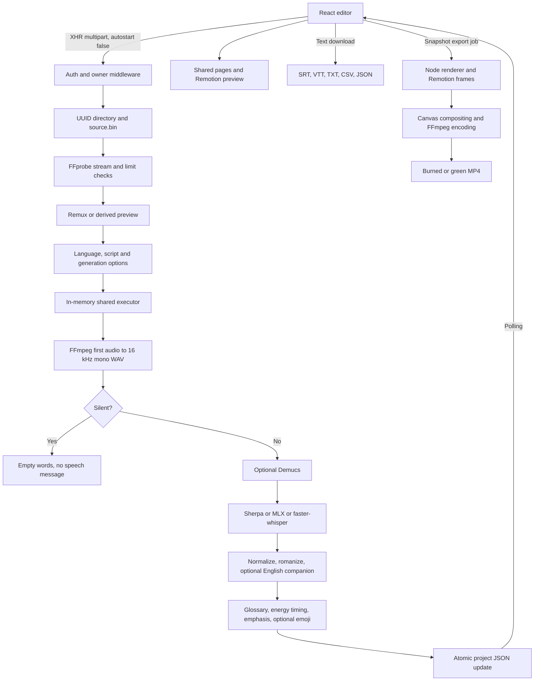

# Actual end-to-end pipeline

Audited 8–9 October 2026 (Asia/Kolkata). Baseline: `d9691b668312dfdc4adc22310698b8b073921b14` plus the pre-existing working-tree changes fingerprinted in [inventory.json](inventory.json). No application source was changed.

Translation changes the ASR task to English audio translation; it is not a downstream text translation box. Frame generation is not AI inference. Optional stages can add a model pass but are sequential dependencies, not independent jobs. The diagram intentionally omits absent LLM generation, database, durable queue and hosted MT API.

Verified runtime path: synthetic4-second video upload → ready project → known fixture words PATCH → browser project open/play/name edit → autosave →720p30fps burned MP4 export completed. This uses seeded captions and therefore does not verify speech recognition. Python 87 and Node 99 tests cover additional contracts. See failure matrix for interrupted paths and evidence/browser-save-export.json for the actual export record.
